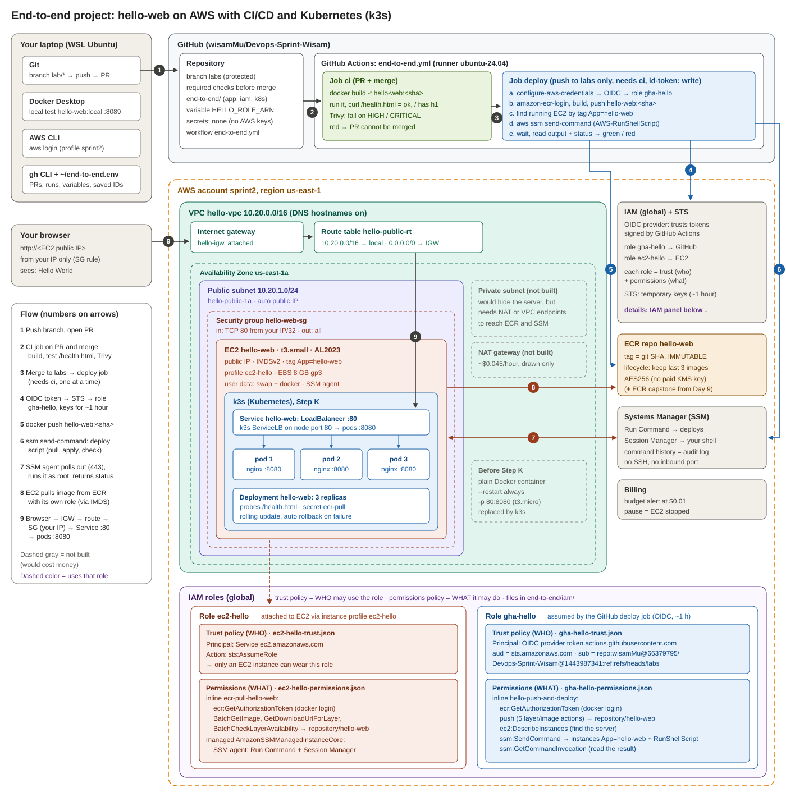

[⬅ Back to labs](../SPRINT.md)

# End-to-End Lab — Hello World on AWS with CI/CD and Kubernetes

**The task (my own, covering Days 1–10):** deploy a Hello World page on AWS from a container image in ECR, in my own VPC and subnet, on an EC2. A CI/CD pipeline in GitHub Actions builds, tests and scans every PR, and every merge into `labs` deploys and health-checks the new version. Then run the same app on Kubernetes (k3s) on that EC2.

**Date:** 2026-11-21/22 · **Where:** WSL Ubuntu 24.04 + AWS CLI (profile `sprint2`, `us-east-1`) + Docker Desktop + GitHub Actions
**Cost:** ≈ $0.03 in total (`t3.micro`/`t3.small` + public IPv4 only while running). Paused: ≈ $0.65/month (8 GB EBS + a few ECR images).
**Result:** `http://<EC2 public IP>` shows **Hello World**, served by 3 Kubernetes pods. Each merge into `labs` builds, tests, scans, pushes `hello-web:<sha>` to ECR, deploys through SSM and health-checks it, with automatic rollback, no AWS keys and no SSH.

> The 12-digit AWS account ID is written as `<ACCOUNT_ID>`.



| Requirement | Result |
|---|---|
| Hello World page in a container | ✅ `nginx-unprivileged` (uid 101, port 8080), `HEALTHCHECK` on `/health.html` |
| Image in ECR | ✅ `hello-web` (IMMUTABLE, AES256, keep last 3), tagged with the git SHA |
| Own VPC + subnet | ✅ `10.20.0.0/16`, public subnet `10.20.1.0/24`, IGW, route table, SG port 80 from my IP only |
| Runs on EC2 | ✅ `hello-web` (AL2023, IMDSv2, instance profile `ec2-hello`, no SSH) |
| CI on every PR | ✅ build → run + `curl /health.html` → Trivy |
| CD on merge | ✅ OIDC role `gha-hello` → push to ECR → SSM Run Command → deploy → health check |
| Health checks | ✅ image, CI, Kubernetes readiness/liveness, after deploy |
| Kubernetes on AWS | ✅ k3s: Deployment (3 replicas) + Service, self-healing, scaling, rolling update, rollback |
| Pause / resume | ✅ stop the EC2 between demos; k3s and the pods come back by themselves |

| Step | What | Goal | Sprint days |
|---|---|---|---|
| [A](#a--the-app-and-the-image) | App + image | A tiny, non-root, self-checking web image | 6, 7 |
| [B](#b--ecr-and-the-github-role) | ECR + GitHub role | A place for images and a key-less identity for the pipeline | 9 |
| [C](#c--your-own-vpc) | Own VPC | A private network that only I can reach | 3 |
| [D](#d--the-ec2) | EC2 | A server that pulls the image and is managed without SSH | 1, 2, 10 |
| [E](#e--the-pipeline) | Pipeline | Every PR tested, every merge deployed and verified | 8, 9 |
| [F](#f--ship-it) | Ship it | Prove the whole chain end to end | 4 |
| [G](#g--pause) / [H](#h--resume-for-a-demo) | Pause / resume | Pay almost nothing between demos; back online in ~2 minutes | — |
| [K](#k--kubernetes-k3s-on-the-ec2) | Kubernetes (k3s) | The same app run by Kubernetes on AWS | 10 |
| [I](#i--teardown-after-the-last-demo) | Teardown | Delete everything in the right order | 3 |

> **Before every session (WSL):** Docker Desktop is running (`docker version`), then `export AWS_PROFILE=sprint2 AWS_REGION=us-east-1` and `source ~/end-to-end.env`. If AWS says *"Unable to load … login session"*, run `aws login --profile sprint2`.
> **WSL** = my laptop · **EC2** = inside the server (`sh-5.2$`, opened with `aws ssm start-session`).

---

## Every service and its goal

### GitHub
| Item | Goal |
|---|---|
| Repository | Single source of truth: app, policies, manifests, workflow |
| Protected branch `labs` | Only reviewed code that passed the checks can land, so only tested code is deployed |
| Job `ci` | Quality gate: build, test `/health.html`, scan with Trivy |
| Job `deploy` | Delivery: push to ECR, deploy to the EC2, health-check, roll back on failure |
| Variable `HELLO_ROLE_ARN` | Which AWS role the workflow becomes (an address, not a secret) |
| No secrets | Proof that no AWS keys are stored anywhere |

### AWS: network
| Item | Goal |
|---|---|
| VPC `10.20.0.0/16` | My own private, isolated network in AWS |
| Public subnet `10.20.1.0/24` (`us-east-1a`) | The slice of the VPC for servers that need the internet |
| Auto-assign public IP | Gives the EC2 an internet address |
| Internet gateway | The VPC's door to the internet, in and out |
| Route table | `10.20.0.0/16` stays local, `0.0.0.0/0` goes to the IGW: this makes the subnet public |
| Security group | The server's firewall: only port 80 from my IP; no SSH |
| *Private subnet + NAT (not built)* | Would hide the server; skipped because NAT is paid |

### AWS: server and app
| Item | Goal |
|---|---|
| EC2 `hello-web` | The computer that runs the website |
| `t3.micro` → `t3.small` | 1 GB RAM for Docker; 2 GB once k3s runs |
| EBS 8 GB | The server's disk: OS, k3s, images. Survives a pause. |
| User data | Boot script: swap + Docker set up automatically on first boot |
| IMDSv2 | Hands the server its role's temporary keys safely |
| Tag `App=hello-web` | The pipeline finds the server by it, and may only deploy to tagged servers |
| SSM agent | Lets AWS run commands and open shells with no SSH and no open port |
| k3s | Lightweight, certified Kubernetes on the EC2 (no paid EKS control plane) |
| Deployment / pods | Keep 3 copies running at the declared version |
| Service (LoadBalancer :80) | One stable address across ready pods (k3s ServiceLB, no AWS load balancer) |
| Probes on `/health.html` | Readiness: traffic only to ready pods. Liveness: restart a hung container. |
| Secret `ecr-pull` | Lets Kubernetes pull from private ECR |

### AWS: services
| Item | Goal |
|---|---|
| ECR `hello-web` | Image warehouse: every version, tagged by git SHA |
| IMMUTABLE tags | One SHA = one exact image, never overwritten |
| Lifecycle policy | Keeps the last 3 images, so storage stays cheap |
| OIDC provider | Makes AWS trust GitHub's signed tokens |
| Role `gha-hello` | The identity GitHub borrows to push and deploy |
| Role + profile `ec2-hello` | The identity the server wears to pull images and talk to SSM |
| Trust / permissions policy | WHO may use a role / WHAT it may do, on which resources |
| STS | Temporary keys (~1 hour) when a role is assumed |
| SSM Run Command / Session Manager | Delivers the deploy script / gives me a shell, without SSH |
| Budget alert | Emails me as soon as anything costs money |

---

## A — The app and the image
**Goal:** a tiny, secure, self-checking web image. **Why:** every later step (CI, ECR, EC2, Kubernetes) ships this exact image. **Where:** WSL.

### A.1 Branch and folder
```bash
cd ~/Devops-Sprint-Wisam
git switch labs && git pull
git switch -c lab/end-to-end
mkdir -p end-to-end/hello-web
```
| Part | Meaning |
|---|---|
| `git switch labs && git pull` | Start from the latest `labs` |
| `git switch -c lab/end-to-end` | A new branch for the task (`labs` is protected) |
| `mkdir -p end-to-end/hello-web` | The project's own folder |

### A.2 The pages and the Dockerfile
Files: [index.html](hello-web/index.html), [health.html](hello-web/health.html) (`ok`), [Dockerfile](hello-web/Dockerfile), [.dockerignore](hello-web/.dockerignore).

```dockerfile
FROM nginxinc/nginx-unprivileged:1.31.7-alpine
USER root
RUN apk upgrade --no-cache
USER nginx
COPY --chown=nginx:nginx index.html health.html /usr/share/nginx/html/
EXPOSE 8080
HEALTHCHECK --interval=30s --timeout=3s --start-period=5s --retries=3 \
  CMD wget -qO- http://127.0.0.1:8080/health.html || exit 1
```
| Line | Meaning |
|---|---|
| `nginx-unprivileged:1.31.7-alpine` | Small nginx that runs as non-root (uid 101) on port 8080; pinned version |
| `USER root` → `apk upgrade` → `USER nginx` | Patch OS packages so Trivy is clean, then drop root |
| `COPY --chown=nginx:nginx` | The pages are owned by the runtime user |
| `HEALTHCHECK … /health.html` | Docker marks a broken container `unhealthy` |
| `health.html` = `ok` | One health endpoint used by Docker, CI, CD and Kubernetes |
| `.dockerignore` | Only the 2 pages go into the build |

### A.3 Build and test locally
```bash
docker build \
  -t hello-web:local \
  end-to-end/hello-web

docker run -d \
  --name hello \
  -p 8089:8080 \
  hello-web:local

curl -s localhost:8089/health.html
curl -s localhost:8089/ | grep -o '<h1>.*</h1>'
docker exec hello id
docker rm -f hello
```
| Part | Meaning |
|---|---|
| `-p 8089:8080` | Laptop port 8089 → container port 8080 (8088 was used by the Day 7 stack) |
| Expected | `ok`, `<h1>Hello World</h1>`, `Up … (healthy)`, `uid=101(nginx)` |

---

## B — ECR and the GitHub role
**Goal:** a private registry, and an AWS identity GitHub can borrow. **Why:** GitHub must push and deploy without stored AWS keys. **Where:** WSL.

### B.1 Session
```bash
export AWS_PROFILE=sprint2
export AWS_REGION=us-east-1
aws sts get-caller-identity --query Arn --output text
ACCOUNT_ID=$(aws sts get-caller-identity --query Account --output text)
```

### B.2 ECR repository `hello-web`
```bash
aws ecr create-repository \
  --repository-name hello-web \
  --image-tag-mutability IMMUTABLE \
  --encryption-configuration encryptionType=AES256 \
  --tags Key=Project,Value=devops-sprint Key=App,Value=hello-web

aws ecr put-lifecycle-policy \
  --repository-name hello-web \
  --lifecycle-policy-text '{
    "rules": [{
      "rulePriority": 1,
      "description": "keep the last 3 images",
      "selection": { "tagStatus": "any", "countType": "imageCountMoreThan", "countNumber": 3 },
      "action": { "type": "expire" }
    }]
  }'
```
| Part | Meaning |
|---|---|
| `IMMUTABLE` | A tag can never be overwritten: one SHA = one image |
| `AES256` | Free encryption at rest (KMS would cost money) |
| Lifecycle "keep last 3" | Older images expire automatically |

### B.3 Role `gha-hello`
Trust policy (WHO): [iam/gha-hello-trust.json](iam/gha-hello-trust.json) · Permissions (WHAT): [iam/gha-hello-permissions.json](iam/gha-hello-permissions.json)

```bash
aws iam create-role \
  --role-name gha-hello \
  --assume-role-policy-document file:///tmp/hello-trust.json \
  --description "GitHub Actions (labs): push hello-web to ECR and deploy it via SSM" \
  --max-session-duration 3600 \
  --tags Key=Project,Value=devops-sprint Key=App,Value=hello-web

aws iam put-role-policy \
  --role-name gha-hello \
  --policy-name hello-push-and-deploy \
  --policy-document file:///tmp/hello-perms.json
```
| Trust part | Meaning |
|---|---|
| `Principal.Federated … oidc-provider` | Trust tokens signed by GitHub (the provider from Day 9) |
| `sts:AssumeRoleWithWebIdentity` | Swap a GitHub token for temporary AWS keys |
| `aud = sts.amazonaws.com` | The token was made for AWS |
| `sub = repo:wisamMu@66379795/Devops-Sprint-Wisam@1443987341:ref:refs/heads/labs` | Only this repo (by immutable IDs) and only the `labs` branch |

| Permission statement | Goal |
|---|---|
| `EcrLogin` | Docker login to ECR (registry-wide, so `*`) |
| `PushHelloWebOnly` | Push to the `hello-web` repository only |
| `FindTheInstance` | Find the server by its tag |
| `RunCommandOnHelloInstancesOnly` + `OnlyTheShellScriptDocument` | `ssm:SendCommand` only to instances tagged `App=hello-web`, only with `AWS-RunShellScript` |
| `ReadCommandResults` | Read the server's output, so the pipeline can turn red |

### B.4 GitHub variable
```bash
HELLO_ROLE_ARN=$(aws iam get-role \
  --role-name gha-hello \
  --query 'Role.Arn' \
  --output text)

gh variable set HELLO_ROLE_ARN --body "$HELLO_ROLE_ARN"
gh secret list
```
`gh secret list` is empty: an ARN is an address, not a secret. The policy copies in [iam/](iam/) were saved with the account ID replaced by `<ACCOUNT_ID>` (`sed "s/$ACCOUNT_ID/<ACCOUNT_ID>/g"`).

---

## C — Your own VPC
**Goal:** a private network I control, where only I can open the page. **Why:** Day 3 networking for real. **Where:** WSL.

### C.1 VPC and public subnet
```bash
VPC_ID=$(aws ec2 create-vpc \
  --cidr-block 10.20.0.0/16 \
  --tag-specifications 'ResourceType=vpc,Tags=[{Key=Name,Value=hello-vpc},{Key=Project,Value=devops-sprint}]' \
  --query Vpc.VpcId \
  --output text)

aws ec2 modify-vpc-attribute \
  --vpc-id "$VPC_ID" \
  --enable-dns-hostnames

SUBNET_ID=$(aws ec2 create-subnet \
  --vpc-id "$VPC_ID" \
  --cidr-block 10.20.1.0/24 \
  --availability-zone us-east-1a \
  --tag-specifications 'ResourceType=subnet,Tags=[{Key=Name,Value=hello-public-1a},{Key=Project,Value=devops-sprint}]' \
  --query Subnet.SubnetId \
  --output text)

aws ec2 modify-subnet-attribute \
  --subnet-id "$SUBNET_ID" \
  --map-public-ip-on-launch

printf 'VPC_ID=%s\nSUBNET_ID=%s\n' "$VPC_ID" "$SUBNET_ID" > ~/end-to-end.env
```
| Part | Meaning |
|---|---|
| `10.20.0.0/16` | 65,536 private addresses, no overlap with the default VPC |
| `--enable-dns-hostnames` | Instances get DNS names |
| `10.20.1.0/24` in `us-east-1a` | 256 addresses in one data center |
| `--map-public-ip-on-launch` | New instances get a public IP automatically |
| `~/end-to-end.env` | All IDs saved for later steps and teardown |

### C.2 Internet gateway and route table
```bash
IGW_ID=$(aws ec2 create-internet-gateway \
  --tag-specifications 'ResourceType=internet-gateway,Tags=[{Key=Name,Value=hello-igw},{Key=Project,Value=devops-sprint}]' \
  --query InternetGateway.InternetGatewayId \
  --output text)

aws ec2 attach-internet-gateway \
  --internet-gateway-id "$IGW_ID" \
  --vpc-id "$VPC_ID"

RTB_ID=$(aws ec2 create-route-table \
  --vpc-id "$VPC_ID" \
  --tag-specifications 'ResourceType=route-table,Tags=[{Key=Name,Value=hello-public-rt},{Key=Project,Value=devops-sprint}]' \
  --query RouteTable.RouteTableId \
  --output text)

aws ec2 create-route \
  --route-table-id "$RTB_ID" \
  --destination-cidr-block 0.0.0.0/0 \
  --gateway-id "$IGW_ID"

ASSOC_ID=$(aws ec2 associate-route-table \
  --route-table-id "$RTB_ID" \
  --subnet-id "$SUBNET_ID" \
  --query AssociationId \
  --output text)

printf 'IGW_ID=%s\nRTB_ID=%s\nASSOC_ID=%s\n' "$IGW_ID" "$RTB_ID" "$ASSOC_ID" >> ~/end-to-end.env
```
| Part | Meaning |
|---|---|
| IGW + `attach` | The VPC's door to the internet |
| Route `0.0.0.0/0 → IGW` | Everything not local goes out through the door |
| `associate-route-table` | Apply it to the subnet: now the subnet is public |

### C.3 Security group: port 80 from my IP only
```bash
MY_IP=$(curl -fsS https://checkip.amazonaws.com)

SG_ID=$(aws ec2 create-security-group \
  --group-name hello-web-sg \
  --description "hello-web: HTTP 80 from my IP only; no SSH" \
  --vpc-id "$VPC_ID" \
  --tag-specifications 'ResourceType=security-group,Tags=[{Key=Name,Value=hello-web-sg},{Key=Project,Value=devops-sprint}]' \
  --query GroupId \
  --output text)

aws ec2 authorize-security-group-ingress \
  --group-id "$SG_ID" \
  --ip-permissions "IpProtocol=tcp,FromPort=80,ToPort=80,IpRanges=[{CidrIp=${MY_IP}/32,Description=my-ip}]"

echo "SG_ID=$SG_ID" >> ~/end-to-end.env
```
| Part | Meaning |
|---|---|
| `checkip.amazonaws.com` | My current public IP |
| `tcp 80`, `CidrIp=<ip>/32` | HTTP from exactly one address |
| No port 22 | No SSH; Session Manager instead |

---

## D — The EC2
**Goal:** a server that pulls the image and is managed with no SSH and no stored keys. **Why:** instance profile, user data and systemd (Days 1, 2, 10). **Where:** WSL.

### D.1 Role and instance profile `ec2-hello`
Trust: [iam/ec2-hello-trust.json](iam/ec2-hello-trust.json) (`ec2.amazonaws.com` only) · Pull permissions: [iam/ec2-hello-permissions.json](iam/ec2-hello-permissions.json)

```bash
aws iam create-role \
  --role-name ec2-hello \
  --assume-role-policy-document file:///tmp/ec2-hello-trust.json \
  --description "hello-web EC2: SSM + pull hello-web"

aws iam attach-role-policy \
  --role-name ec2-hello \
  --policy-arn arn:aws:iam::aws:policy/AmazonSSMManagedInstanceCore

aws iam put-role-policy \
  --role-name ec2-hello \
  --policy-name ecr-pull-hello-web \
  --policy-document file:///tmp/ec2-hello-pull.json

aws iam create-instance-profile \
  --instance-profile-name ec2-hello

aws iam add-role-to-instance-profile \
  --instance-profile-name ec2-hello \
  --role-name ec2-hello
```
| Part | Meaning |
|---|---|
| `AmazonSSMManagedInstanceCore` | The SSM agent can register, run commands and open sessions |
| `ecr-pull-hello-web` | Pull-only, from one repository |
| Instance profile | The holder that attaches a role to an EC2 |

### D.2 User data and launch
Boot script: [userdata.sh](userdata.sh) (1 GB swap in `/etc/fstab`, `dnf install docker`, `systemctl enable --now docker`, logged to `/var/log/hello-userdata.log`).

```bash
AMI_ID=$(aws ssm get-parameter \
  --name /aws/service/ami-amazon-linux-latest/al2023-ami-kernel-default-x86_64 \
  --query Parameter.Value \
  --output text)

INSTANCE_ID=$(aws ec2 run-instances \
  --image-id "$AMI_ID" \
  --instance-type t3.micro \
  --subnet-id "$SUBNET_ID" \
  --security-group-ids "$SG_ID" \
  --iam-instance-profile Name=ec2-hello \
  --metadata-options HttpTokens=required,HttpEndpoint=enabled \
  --user-data file://end-to-end/userdata.sh \
  --tag-specifications \
    'ResourceType=instance,Tags=[{Key=Name,Value=hello-web},{Key=App,Value=hello-web},{Key=Project,Value=devops-sprint}]' \
    'ResourceType=volume,Tags=[{Key=Project,Value=devops-sprint}]' \
  --query 'Instances[0].InstanceId' \
  --output text)

echo "INSTANCE_ID=$INSTANCE_ID" >> ~/end-to-end.env
```
| Part | Meaning |
|---|---|
| `ssm get-parameter … al2023` | The latest Amazon Linux 2023 image, without hard-coding its ID |
| `t3.micro` | Cheapest general type; resized to `t3.small` in Step K |
| `--iam-instance-profile Name=ec2-hello` | The server wears the role: no keys on disk |
| `HttpTokens=required` | IMDSv2 only |
| Tag `App=hello-web` | The only instances the pipeline may deploy to |

### D.3 Wait, then check the boot script through SSM
```bash
aws ec2 wait instance-status-ok --instance-ids "$INSTANCE_ID" && echo "instance OK"

CMD_ID=$(aws ssm send-command \
  --instance-ids "$INSTANCE_ID" \
  --document-name AWS-RunShellScript \
  --comment "check user data" \
  --parameters 'commands=["tail -3 /var/log/hello-userdata.log","systemctl is-active docker","swapon --show --noheadings"]' \
  --query Command.CommandId \
  --output text)

aws ssm wait command-executed \
  --command-id "$CMD_ID" \
  --instance-id "$INSTANCE_ID"

aws ssm get-command-invocation \
  --command-id "$CMD_ID" \
  --instance-id "$INSTANCE_ID" \
  --query '[Status,StandardOutputContent]' \
  --output text
```
`send-command` runs shell lines on the server with no SSH. It's the same mechanism the pipeline uses to deploy.

---

## E — The pipeline
**Goal:** every PR is built, tested and scanned; every merge is pushed, deployed and health-checked. **Why:** CI (Day 8) + OIDC (Day 9) = CI/CD. **Where:** WSL.

Workflow: [.github/workflows/end-to-end.yml](../.github/workflows/end-to-end.yml)

| Part | Goal |
|---|---|
| `on: pull_request / push` + `paths` | Run on PRs and merges into `labs`, only when the project changes |
| `workflow_dispatch` | Manual run (e.g. after resuming the server) |
| Job `ci`: build → run + `curl /health.html` → Trivy | A broken or vulnerable image can't be merged |
| `needs: ci` | Deploy only after CI passes |
| `if: … != 'pull_request' && ref == labs` | Never deploy from a PR |
| `concurrency: deploy-hello-web` | One deploy at a time |
| `id-token: write` + `configure-aws-credentials` | GitHub OIDC token → 1-hour keys of role `gha-hello` |
| `amazon-ecr-login` → push `hello-web:${{ github.sha }}` | Every image traceable to exactly one commit |
| Find instance by tag `App=hello-web`, `running` | A clear error if the server is paused |
| Deploy step (SSM) | First version: `docker pull` + `docker run -p 80:8080`. Replaced in Step K by the Kubernetes version. |

Lint before pushing:
```bash
docker run --rm -i \
  rhysd/actionlint:1.7.12 \
  -color=false - \
  < .github/workflows/end-to-end.yml \
  && echo "actionlint OK"
```

---

## F — Ship it
**Goal:** prove the chain PR → checks → merge → ECR → EC2 → browser. **Why:** Git flow (Day 4) plus everything above. **Where:** WSL.

```bash
git add end-to-end/ .github/workflows/end-to-end.yml
git diff --cached | grep -E '[0-9]{12}' || echo "no account ID staged"
git commit -m "feat(end-to-end): hello-web on EC2 with CI/CD (OIDC, ECR, SSM, health checks)"
git push -u origin lab/end-to-end

gh pr create \
  --base labs \
  --head lab/end-to-end \
  --title "feat(end-to-end): hello-web on AWS with CI/CD" \
  --body "Build, test and scan on PRs; on merge push to ECR via OIDC and deploy to EC2 via SSM."

gh pr checks --watch
gh pr merge --squash --delete-branch
git switch labs && git pull

RUN_ID=$(gh run list \
  --workflow end-to-end.yml \
  --branch labs \
  --limit 1 \
  --json databaseId \
  --jq '.[0].databaseId')

gh run watch "$RUN_ID" --exit-status
```
```bash
PUBLIC_IP=$(aws ec2 describe-instances \
  --instance-ids "$INSTANCE_ID" \
  --query 'Reservations[0].Instances[0].PublicIpAddress' \
  --output text)

curl -s "http://$PUBLIC_IP/health.html"
curl -s "http://$PUBLIC_IP/" | grep -o '<h1>.*</h1>'
```
| Part | Meaning |
|---|---|
| `grep -E '[0-9]{12}'` | Make sure no account ID is about to go public |
| `gh pr checks --watch` | Required checks + `hello-web CI` pass; `deploy` is skipped on PRs |
| `gh pr merge --squash` | One commit on `labs`; the push starts the deploy |
| Expected | `ok` and `<h1>Hello World</h1>` |

> The first deploy failed with *"repository hello-web does not exist"* (B.2 had been skipped after the `aws login` session expired). Created the repo, then `gh run rerun <id> --failed` → green.

---

## G — Pause
**Goal:** stop paying by the hour, keep everything for the demo. **Why:** a stopped EC2 has no compute or IP charge; only the 8 GB disk. **Where:** WSL.

```bash
aws ec2 stop-instances \
  --instance-ids "$INSTANCE_ID" \
  --query 'StoppingInstances[0].CurrentState.Name' \
  --output text

aws ec2 wait instance-stopped --instance-ids "$INSTANCE_ID" && echo "paused"
```
While paused, don't merge into `labs`: the deploy would fail with "No running hello-web instance".

## H — Resume for a demo
**Goal:** back online in ~2 minutes. **Why:** Docker/k3s start at boot; only the IPs change. **Where:** WSL.

```bash
aws ec2 start-instances \
  --instance-ids "$INSTANCE_ID" \
  --query 'StartingInstances[0].CurrentState.Name' \
  --output text

aws ec2 wait instance-status-ok --instance-ids "$INSTANCE_ID" && echo "running"

PUBLIC_IP=$(aws ec2 describe-instances \
  --instance-ids "$INSTANCE_ID" \
  --query 'Reservations[0].Instances[0].PublicIpAddress' \
  --output text)

MY_IP=$(curl -fsS https://checkip.amazonaws.com)

OLD_CIDR=$(aws ec2 describe-security-groups \
  --group-ids "$SG_ID" \
  --query 'SecurityGroups[0].IpPermissions[?FromPort==`80`].IpRanges[0].CidrIp' \
  --output text)

echo "allowed: $OLD_CIDR   now: $MY_IP/32"
```
Only if the two are different:
```bash
aws ec2 revoke-security-group-ingress \
  --group-id "$SG_ID" \
  --protocol tcp \
  --port 80 \
  --cidr "$OLD_CIDR"

aws ec2 authorize-security-group-ingress \
  --group-id "$SG_ID" \
  --protocol tcp \
  --port 80 \
  --cidr "$MY_IP/32"
```
| Part | Meaning |
|---|---|
| `PUBLIC_IP` | The new address (it changes on every stop/start) |
| `OLD_CIDR` | The IP the firewall allows right now |
| `revoke` / `authorize` | Remove the old IP, allow the current one |
| `gh workflow run end-to-end.yml --ref labs` | Optional: redeploy the latest `labs` |

---

## K — Kubernetes (k3s) on the EC2
**Goal:** the same image, deployed by the same pipeline, run by Kubernetes on AWS: 3 replicas, self-healing, zero-downtime rolling updates, rollback. **Why:** Day 10 on a real cloud server. k3s is a lightweight, certified Kubernetes in one binary: no EKS control plane ($0.10/h), and the EC2 can still be paused.

| Choice | Why |
|---|---|
| k3s on the existing EC2 | EKS can't be paused; k3s adds nothing to the bill |
| Resize to `t3.small` (2 GB) | k3s + pods need ~1 GB more than plain Docker |
| `--disable traefik` | Frees port 80 for our Service |
| Service `type: LoadBalancer` | k3s ServiceLB holds port 80 on the node: no paid AWS load balancer |
| `imagePullSecrets: ecr-pull` | Pull from private ECR with a token from the EC2's role, refreshed on every deploy |
| Docker disabled | k3s has its own containerd; frees RAM and port 80 |

### K.1 Resize and start (WSL)
```bash
aws ec2 modify-instance-attribute \
  --instance-id "$INSTANCE_ID" \
  --instance-type '{"Value": "t3.small"}'

aws ec2 start-instances \
  --instance-ids "$INSTANCE_ID" \
  --query 'StartingInstances[0].CurrentState.Name' \
  --output text

aws ec2 wait instance-status-ok --instance-ids "$INSTANCE_ID" && echo "running"
```
The type can only be changed while the instance is stopped. Then **K.2** = the security group update from Step H.

### K.3 Install k3s (EC2)
```bash
aws ssm start-session --target "$INSTANCE_ID"
```
At `sh-5.2$`:
```bash
sudo docker rm -f hello-web
sudo systemctl disable --now docker docker.socket

curl -sfL https://get.k3s.io \
  | sudo INSTALL_K3S_EXEC="server --disable traefik --write-kubeconfig-mode 644" sh -

sudo systemctl is-enabled k3s
kubectl get nodes -o wide
kubectl get pods -A
exit
```
| Part | Meaning |
|---|---|
| `disable --now docker docker.socket` | Retire plain Docker: frees port 80 and RAM |
| `get.k3s.io … sh -` | Installer: binary + `kubectl`, systemd service `k3s`, kubeconfig `/etc/rancher/k3s/k3s.yaml`, built-ins (containerd, flannel, coredns, ServiceLB) |
| `server` | Control plane + worker on one machine |
| `--write-kubeconfig-mode 644` | `kubectl` works without `sudo` |
| `is-enabled k3s` → `enabled` | Kubernetes comes back after pause/resume |

The installer configured Kubernetes (an empty cluster); our YAML configures the app; the pipeline delivers that YAML on every merge.

### K.4 Manifests and the new deploy step
[k8s/deployment.yaml](k8s/deployment.yaml):

| Line | Meaning |
|---|---|
| `replicas: 3` | Always keep 3 pods running |
| `revisionHistoryLimit: 5` | Keep 5 old ReplicaSets for rollback |
| `progressDeadlineSeconds: 120` | A rollout that doesn't finish in 2 minutes is marked failed |
| `maxSurge: 1` / `maxUnavailable: 0` | One pod at a time, never below 3 ready: zero downtime |
| `selector` + `template.labels: app=hello-web` | Marks "my pods"; the Service uses the same label |
| `imagePullSecrets: ecr-pull` | Log in to private ECR |
| `runAsNonRoot` + `runAsUser: 101` / `runAsGroup: 101` | Refuse root; Kubernetes needs the user as a number |
| `image: IMAGE_PLACEHOLDER` | The pipeline replaces it with `…/hello-web:<git-sha>` |
| `imagePullPolicy: IfNotPresent` | Use the cached image after a pause |
| `readinessProbe` (3 s) / `livenessProbe` (10 s) on `/health.html` | Traffic only to ready pods / restart a hung container |
| `requests` / `limits` | Reserved minimum / RAM ceiling that protects the 2 GB node |

[k8s/service.yaml](k8s/service.yaml): `type: LoadBalancer`, `selector: app: hello-web`, `port: 80 → targetPort: 8080`.

The Secret `ecr-pull` has no YAML on purpose: the ECR password expires after 12 hours and must never be in Git, so the pipeline creates it on every deploy.

New last step in the workflow (run on the EC2 through SSM):

| Command on the EC2 | Goal |
|---|---|
| `export KUBECONFIG=/etc/rancher/k3s/k3s.yaml` | Tell `kubectl` where the cluster is |
| `kubectl create secret docker-registry ecr-pull … --dry-run=client -o yaml \| kubectl apply -f -` | Create/update `ecr-pull` with a fresh ECR token from the EC2's role |
| `echo <base64> \| base64 -d > /tmp/hello-web.yaml` | The runner ships both manifests with the real image filled in |
| `kubectl apply -f /tmp/hello-web.yaml` | Declarative deploy: the cluster becomes what Git says |
| `kubectl annotate … change-cause` | A readable `rollout history` |
| `rollout status` or `rollout undo` + `exit 1` | Automatic rollback if new pods never become ready |
| `curl localhost/health.html` | End-to-end check through the Service |

The runner then polls `ssm get-command-invocation` for up to 5 minutes (the built-in `aws ssm wait` gives up after 100 s, shorter than a rollout) and turns red unless the status is `Success`.

Shipped in PR #22. The first k3s deploy failed with `CreateContainerConfigError`: `runAsNonRoot` can't verify the image's user name `nginx`, only a number. PR #23 added `runAsUser: 101` and the 5-minute wait → green.

### K.5 Verify (EC2)
```bash
kubectl get deploy,rs,pods,svc -l app=hello-web -o wide
kubectl get endpointslices -l kubernetes.io/service-name=hello-web
kubectl rollout history deployment/hello-web
```
Deployment `3/3`, 3 pods `Running`, Service `LoadBalancer` on 80, 3 ready pod IPs behind it, history with the image per revision.

### K.6 Self-healing and scaling (EC2)
```bash
kubectl delete pod \
  "$(kubectl get pods -l app=hello-web -o jsonpath='{.items[0].metadata.name}')" \
  --wait=false

sleep 10; kubectl get pods -l app=hello-web

kubectl scale deployment hello-web --replicas=5
kubectl rollout status deployment/hello-web
kubectl get deploy hello-web
exit
```
| What happened | Meaning |
|---|---|
| A new pod appeared within seconds | ReplicaSet: "desired 3, have 2" |
| The dead pod's IP left the endpoints, the new one joined | The Service follows ready pods by label |
| `5/5` after scaling, no new revision | Only the count changed, not the pod template |
| Next deploy → back to 3 | `kubectl apply` restores the YAML: Git wins |

### K.7 Ship v1.1, then roll back
```bash
git switch labs && git pull
git switch -c lab/hello-v11

sed -i 's|<h1>Hello World</h1>|<h1>Hello World v1.1</h1>|' \
  end-to-end/hello-web/index.html

git add end-to-end/hello-web/index.html
git commit -m "feat(hello-web): v1.1 heading"
git push -u origin lab/hello-v11

gh pr create \
  --base labs \
  --head lab/hello-v11 \
  --title "feat(hello-web): v1.1" \
  --body "Visible change to watch a Kubernetes rolling update."

gh pr checks --watch
gh pr merge --squash --delete-branch
```
PR #24 → `<h1>Hello World v1.1</h1>`. Watching `kubectl get pods -l app=hello-web -w` on the EC2: each new pod became Ready before an old one stopped; never fewer than 3 ready.

Emergency rollback (EC2):
```bash
kubectl rollout history deployment/hello-web
kubectl rollout undo deployment/hello-web
kubectl rollout status deployment/hello-web
exit
```
| Part | Meaning |
|---|---|
| `rollout undo` | Back to the previous revision in seconds: the old ReplicaSet and image are still on the server |
| History after | The old revision comes back with a new number |
| `last-applied-configuration` warning | The cluster now differs from Git: the next merge would bring v1.1 back |

### K.8 Make Git match the cluster (still to do, at the next resume)
```bash
git switch labs && git pull
git switch -c revert/hello-v11

git revert --no-edit HEAD
git push -u origin revert/hello-v11

gh pr create \
  --base labs \
  --head revert/hello-v11 \
  --title "revert: hello-web v1.1" \
  --body "Make Git match the emergency rollback on the cluster."
```
Rollback = fast, for emergencies, but Git no longer matches. Roll forward (revert/fix PR) = slower, but Git is the truth again. Always do both.

---

## I — Teardown (after the last demo)
**Goal:** delete everything in an order AWS accepts. **Why:** resources depend on each other; the VPC goes last. **Where:** WSL.

```bash
aws ec2 terminate-instances --instance-ids "$INSTANCE_ID"
aws ec2 wait instance-terminated --instance-ids "$INSTANCE_ID" && echo "instance gone"

aws ec2 delete-security-group --group-id "$SG_ID"

aws ec2 disassociate-route-table --association-id "$ASSOC_ID"
aws ec2 delete-route-table --route-table-id "$RTB_ID"

aws ec2 detach-internet-gateway \
  --internet-gateway-id "$IGW_ID" \
  --vpc-id "$VPC_ID"
aws ec2 delete-internet-gateway --internet-gateway-id "$IGW_ID"

aws ec2 delete-subnet --subnet-id "$SUBNET_ID"
aws ec2 delete-vpc --vpc-id "$VPC_ID"

aws ecr delete-repository \
  --repository-name hello-web \
  --force
```
Optional (IAM is free to keep):
```bash
aws iam delete-role-policy --role-name gha-hello --policy-name hello-push-and-deploy
aws iam delete-role --role-name gha-hello

aws iam remove-role-from-instance-profile \
  --instance-profile-name ec2-hello \
  --role-name ec2-hello
aws iam delete-instance-profile --instance-profile-name ec2-hello

aws iam detach-role-policy \
  --role-name ec2-hello \
  --policy-arn arn:aws:iam::aws:policy/AmazonSSMManagedInstanceCore
aws iam delete-role-policy --role-name ec2-hello --policy-name ecr-pull-hello-web
aws iam delete-role --role-name ec2-hello

gh variable delete HELLO_ROLE_ARN
gh workflow disable end-to-end.yml
rm ~/end-to-end.env
```
| Order | Why |
|---|---|
| Instance first, and wait | Everything else is in use until it's gone |
| SG → route table → IGW → subnet → VPC | Dependencies; the VPC goes last |
| Policies before roles; role out of the profile first | IAM refuses to delete a role that still has policies or a profile |
| `gh workflow disable` | Future merges won't fail trying to deploy |

---

## Health checks at every level
| Level | How | If it fails |
|---|---|---|
| Image | `HEALTHCHECK` → `/health.html` | Container `unhealthy` |
| CI (PR) | Run the container, `curl /health.html` | PR can't merge |
| Kubernetes readiness | `GET /health.html` every 3 s | Pod gets no traffic; rollout waits |
| Kubernetes liveness | `GET /health.html` every 10 s | Container restarted |
| CD (after deploy) | `rollout status` + `curl localhost/health.html` via SSM | Automatic `rollout undo`; pipeline red |

## Security choices
| Choice | Why |
|---|---|
| No SSH, no port 22 | Shells and deploys through SSM; every command is logged |
| No AWS keys in GitHub | OIDC role trusted only by this repo + `labs` |
| Port 80 from my IP only | Not open to the internet |
| Least privilege | GitHub: push one repo + run commands on tagged instances. EC2: pull one repo. |
| IMDSv2 | Instance credentials protected |
| Non-root | nginx uid 101; `runAsNonRoot` enforced by Kubernetes |
| Scanned images | Trivy on every PR |
| Account ID masked | The repo is public; policy files use `<ACCOUNT_ID>` |

## This project vs. real production
| This project | Real production adds |
|---|---|
| 1 EC2 with k3s | Several nodes in 2+ AZs, EKS or ECS, auto scaling |
| ServiceLB on node port 80 | Application Load Balancer, HTTPS (ACM), a Route 53 domain |
| Infrastructure by CLI | Terraform (Week 3) |
| Merge → prod | dev → staging → prod with approvals |
| Public subnet | Private subnets + NAT / VPC endpoints, WAF |
| Health check at deploy | CloudWatch logs, metrics and alarms 24/7 (Week 3) |
| A static page in a container | For a static site: S3 + CloudFront |
